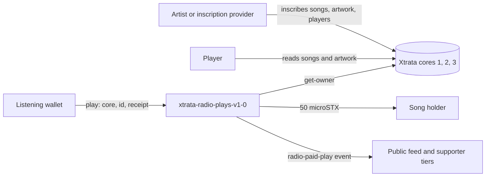
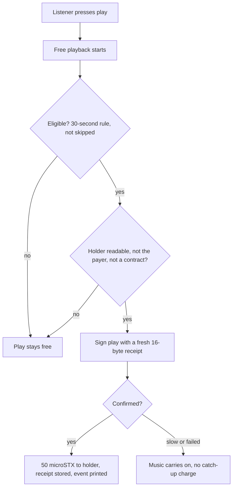

# Xtrata Music Documentation

_Last updated: 20 October 2026. Written for third parties; the repository guides it draws on are listed under Sources._

How a third party inscribes music, builds albums, runs a pay-per-play player and supports paid plays on passkey devices with Xtrata Music. Open questions are listed near the end.

## Overview

Xtrata Music is an on-chain music system on Stacks: every song is an inscription, listening is always free, and a listener can optionally pay the current song holder a few microSTX each time a song has been played long enough to count. Xtrata takes no platform fee.

This document is for four kinds of third party:

- **Artists and labels** who inscribe songs and artwork and want to be paid per play.
- **Player builders** who embed the radio or build their own player, wallet or album experience.
- **Inscription providers** who offer to inscribe audio and artwork for others through Xtrata.
- **Operators** who fund albums, run gift campaigns or support listeners.

Sections marked **Live** describe behaviour that is running on mainnet or the public site as of 20 October 2026, taken from the public pages, the contract and the repository guides. Sections marked **Planned** describe agreed work that is not built yet.

| Component | Status | Where |
| --- | --- | --- |
| Free web radio (FM, Liked, Chain bands) | Live | [radio.xtrata.xyz/radio](https://radio.xtrata.xyz/radio) |
| Embeddable player (compact and minimal) | Live | [Embed page](https://radio.xtrata.xyz/radio/share.html) |
| On-chain likes | Live | [Endorse page](https://radio.xtrata.xyz/radio/endorse) |
| Paid-play contract (50 microSTX to the holder per paid play) | Live | `xtrata-radio-plays-v1-0` |
| Browser passkey listening wallets (key derived from the passkey, 1 STX limit, one wallet per main address, iPhone and Safari support) | Live, switched on by feature flags | radio.xtrata.xyz and wallet.xtrata.xyz |
| Pay-per-play from the web radio (after 30 seconds of audible listening) | Live, switched on by feature flags | radio.xtrata.xyz |
| Desktop app with a local support wallet (Mac 1.0.6, Windows 1.0.9, beta) | Live, beta | [Music lounge](https://xtrata.xyz/music/lounge) |
| Public feed of confirmed paid plays | Live | Music lounge, refreshed every 15 seconds |
| Album players made by the wallet that holds every song (Album First view, likes, cover art, hidden tracks) | Live, made by gift admins | radio.xtrata.xyz |
| Prefunded album batches, claim links, 30-day refunds | Live, admin-only for now | radio.xtrata.xyz |
| Free album drop (one claim link at a time) | Live | [Giveaway](https://xtrata.xyz/giveaway) |
| Inscription SDK (`@xtrata/sdk`, `@xtrata/reconstruction`, 0.2.0, MIT) | Live | npm and the `stxtrata/xtrata` repository |
| Artist portal (wallet sign-in) | Live | [Artist portal](https://xtrata.xyz/music/artist/) |
| Artist pay-per-play reporting in the portal | Planned | Artist portal |
| Listener-to-friend gift of a prepaid player (1 STX at most) | Planned | radio.xtrata.xyz |
| Album as an on-chain inscription with its songs as parents | Planned | Core contracts |



Artists inscribe songs into the cores, players read them, and the contract looks up the holder on the core and pays them when a listening wallet asks.

## Core concepts

A song is identified by a core number and an inscription id, and every paid play pays whoever holds that song at that moment.

| Term | Meaning |
| --- | --- |
| Inscription | A file stored permanently on Stacks through an Xtrata core contract. Songs, artwork and players are all inscriptions. |
| Core | One of three Xtrata contract versions the paid-play contract understands: core 1 is `xtrata-v1-1-1`, core 2 is `xtrata-v2-1-0`, core 3 is `xtrata-v3-2-3`. The same id in two cores is two different songs. |
| Song holder | The current owner of the song inscription, read live from the core with `get-owner`. The holder receives the payment, so selling the inscription moves future income with it. |
| Player | A song inscribed as a self-contained playable page with cover art, credits and lyrics. Linked players point at an existing audio inscription instead of storing a second copy. |
| Paid play | One `play` transaction that pays the holder 50 microSTX and records a receipt. Listening itself is always free. |
| Receipt | A 16-byte value chosen by the payer, unique per payer. It makes a paid play idempotent: the same receipt can never pay twice. |
| Listening wallet | A small, separate wallet used only to pay for plays. It is not the listener's main wallet. |
| Supporter tier | A recognition level from a wallet's lifetime confirmed paid plays: 1 (First Supporter), 100, 1,000, 10,000, 100,000 and 1,000,000. Shown on [Music Heroes](https://xtrata.xyz/music/heroes). |
| Parent | A recursion link that means ownership: the new inscription becomes a child of an inscription you hold. |
| Dependency | A recursion link that means reference: the new inscription uses another inscription's content, and you do not need to own it. |
| Album | An ordered set of songs with a title and a cover, built as one player. Only a wallet that holds every song can create it. Today the album's definition is stored by Xtrata's server and each song stays its own inscription; an on-chain form that uses the songs as parents is planned. |
| Claim link | A URL of the form `https://radio.xtrata.xyz/radio.html#gift=<code>` that anyone can send as text, email or a post. Opening it gives a listener a funded passkey listening wallet and a copy of an album, with no seed phrase. |
| Treasury | A wallet that Xtrata operates to send claims and refunds. It holds other people's money for each batch and is not a smart contract (see Distribution). |

## Listening wallets and passkeys

A listening wallet is a small, separate wallet that holds a few STX so plays can be paid without touching the listener's main wallet. Two forms exist: the desktop app wallet and the browser passkey wallet. Both are Live.

### Desktop app wallet (Live, beta)

- The app creates the wallet on the listener's computer. The key sits in the app's data folder, separate from the installed app, and is protected by the operating system (Electron safeStorage; Windows DPAPI on Windows).
- The recommended balance is around 1 STX. Higher balances are allowed with a reminder.
- Funding never turns payments on. The listener reviews the cost and approves support for each session; it is off after every restart.
- Closing the app stops new payments. A transaction already submitted can still confirm.
- The listener can return the balance to their own address, less one network fee, after pending payments are checked.
- It is a different wallet from the developer wizard wallet. Never delete a wallet folder that may hold funds.

### Browser passkey wallet (Live)

- **No key is stored.** The wallet key is derived from the passkey's PRF output every time the listener unlocks. It lives in memory in the wallet frame and is dropped on lock or when the page closes. Storage on the wallet origin holds only credential ids, addresses and the public link signature.
- **No backup, by design.** If the passkey is lost, the balance is lost. Passkeys that sync (for example through iCloud Keychain or a password manager) can open the same wallet on another device. There is deliberately no password fallback, because the address is public and a password-derived key could be brute-forced offline.
- **A 1 STX limit.** The target balance is 1 STX, and that is all that can be lost. Above 1 STX new paid plays pause and the panel offers **Return excess** and **Return all**. Nothing is ever swept automatically. Below 0.05 STX the radio asks for a top-up. At the default fee, 1 STX covers about 2,850 paid plays.
- **Where it lives.** The wallet runs in its own page, `wallet.xtrata.xyz`, embedded as a frame inside `radio.xtrata.xyz`. A strict content policy means only `radio.xtrata.xyz` may embed it, and script on any other origin cannot reach the key. Passkeys bind to the wallet hostname, so it is permanent. The radio page can ask the frame to do something but cannot approve it: creating, unlocking, setting a return address, approving spending and confirming a return are all buttons inside the frame.
- **Setup.** The listener creates a passkey, which creates the wallet, then sends it a small amount of STX to the address shown. The panel never turns paid plays on by itself.
- **One approval, bounded.** One approval covers up to 1 STX of plays, or seven days in one open tab, whichever ends first. Closing the page drops the key, and the next visit is one passkey tap.
- **Optional main wallet.** A listener with Xverse or Leather can link it: the main wallet signs one SIP-018 message, the listener confirms the full address inside the frame, and the listening wallet countersigns. There is no fee and no spending permission. Likes and paid plays are then credited to the main wallet, so liked playlists and supporter tier follow the listener.
- **No Stacks wallet at all.** A passkey-only listener can create a wallet, receive about 1 STX from anyone, and start paying artists. Returns go to the linked main wallet if there is one, otherwise to an address the listener types, otherwise to the funder: the sender of the first deposit of at least 0.1 STX from a standard address. The listener always confirms the full destination inside the frame.
- **Many wallets, one device.** The device keeps up to 25 wallets and gives each connected main address its own listening wallet. After a fresh unlock, such as a page refresh, the player opens on the first wallet, the plain player. Switching wallets inside an unlocked session resumes each wallet's last song and position.
- **iPhone, iPad and Safari.** WebKit refuses to create a passkey inside a cross-origin frame. On those browsers the passkey is made in a new tab on `wallet.xtrata.xyz/create`, and the radio tab then signs in with it. Signing in, including PRF, works inside the frame.
- **Apps' built-in browsers.** Instagram, Facebook, X, TikTok, LinkedIn and similar apps open links in their own web view, where passkeys are unreliable. The panel detects these from the user agent and offers "Open in Safari" (or Chrome on Android) plus "Copy link".
- **One tab at a time.** The wallet runs in one tab per browser. A second tab plays free.
- **Optional.** Listening stays free. Listeners turn paid plays on to leave on-chain proof that they paid the artist.

### Wallet lifecycle

1. Create the wallet (app install or passkey creation).
2. Show the public funding address and ask for a small deposit on Stacks mainnet.
3. Wait for the deposit to confirm and show the confirmed balance.
4. Let the listener switch paid plays on, as a separate step from funding.
5. Pay for plays while the listener listens, never blocking playback.
6. Offer a return or sweep at any time.

## Pay-per-play

A paid play is one direct call to the `play` function of `xtrata-radio-plays-v1-0`, which pays the current song holder 50 microSTX and records a receipt in the same transaction. The contract has no custody, treasury, administrator or automatic wallet access. It also has no minimum listening time: anyone can call it for any song at any moment, and all it proves is the payment and the receipt.

### What a listener pays

| Item | Amount |
| --- | --- |
| Holder payment (fixed in the contract) | 0.000050 STX (50 microSTX) |
| Default network fee (set by the app; shown before support is enabled) | 0.000300 STX |
| Total per paid play | 0.000350 STX |
| Xtrata platform fee | None |

The network fee never increases automatically. The web radio uses the same default fee. Source: [Music lounge](https://xtrata.xyz/music/lounge) and the radio repository guide.

### How a paid play works

1. The listener presses play. Free playback always starts first.
2. The player decides the play is eligible (see the rules below) and picks the song's core number and inscription id. The web radio always uses core 3 and the id of the song in its catalogue.
3. The player checks the holder with the read-only `get-owner`. If the holder is the listener's own wallet or a contract address, the play stays free.
4. The player generates 16 random bytes as the receipt and signs a `play` call with the listening wallet.
5. The contract pays 50 microSTX from the listener to the holder, stores the receipt, adds one to the song's total and prints a `radio-paid-play` event.
6. The public feed and supporter tiers pick the event up from the chain.

The diagram below shows the same flow.



### Counting rules

| Surface | When a play is paid | Status |
| --- | --- | --- |
| Desktop app | After an audible listening threshold of up to 30 seconds in current builds (receipt format 1: macOS 1.0.4 and Windows 1.0.7 onwards). Older clients recorded a payment at song start, so the contract's totals mix both. | Live, beta |
| Web radio with passkey wallet | After 30 seconds of continuous audible playback. Paused, muted, volume-zero, buffering and seeked-over time does not count, so skips stay free. A song shorter than a minute counts at half its length; if the length is unknown it needs the full 30 seconds. | Live |

The contract cannot tell a skip from a full listen, and the 30-second rule is enforced only in the front end: the contract has no such limit. That decision lives in the player, which is why the timer must be implemented by every third-party player that wants to pay fairly. Audible seconds are reported by the client and are not verified on-chain, so a paid play is not proof that a person listened.

### Failure behaviour

- **Delayed or failed payment.** Music carries on. The start stays free, and there are no catch-up charges. New eligible starts can pay once the outstanding transaction resolves.
- **Repeated receipt.** If a retry reuses the receipt of a play that already confirmed, the contract refuses it with error 103, so a double payment is impossible.
- **One pending payment at a time** is the safe default for a listening wallet, because a stuck transaction blocks every later one from the same wallet. The web radio allows one payment in flight, at most one paid play every 20 seconds, and queues up to 10 plays (for 30 minutes) while a like or payment is in flight.
- **A payment that was signed but may not have reached the network** is re-broadcast with the same signed bytes, never replaced with a new payment. After 30 minutes unseen, the listener can clear it.
- **Kill switch.** Xtrata can switch web paid plays off. Open radios stop new payments at their next check. Transactions already broadcast cannot be recalled.

## Supporting paid plays on passkey devices

When a listener has a working passkey wallet that is unlocked, funded and switched on, the player should pay for every eligible play; in every other state it must keep the music free and nudge toward the next step without ever blocking playback. This section is the recommended integration pattern, built from the contract's rules and the way Xtrata's own radio detects and handles passkey devices.

### Detect the device

A browser that supports passkeys is not enough: the wallet key comes from the passkey's PRF extension, so PRF is the real test.

1. Check that the browser supports WebAuthn (`window.PublicKeyCredential` exists).
2. Ask `PublicKeyCredential.isUserVerifyingPlatformAuthenticatorAvailable()` to learn whether the device can verify the user with a fingerprint, face or screen lock.
3. Prove PRF works. Xtrata's wallet requires two matching PRF results before it shows an address for funding, and again the first time a synced passkey is used on a new device. Devices without PRF get "paid plays aren't available here; listening stays free".
4. Identify the browser. On WebKit (Safari, and every iPhone and iPad browser) create the passkey in a top-level page on the wallet origin, not inside a frame. Sign-in inside the frame works. In an app's built-in browser (named in the user agent), lead with "Open in Safari" or Chrome and a "Copy link" option.
5. Look for an existing listening wallet for this device. A wallet is a stored credential plus its linked main wallet, if any. If the wallet is linked to a different address than the one connected, keep it locked.
6. Read the wallet's confirmed STX balance and whether paid plays are switched on.

### Choose the play mode

| State detected | What the player does |
| --- | --- |
| Wallet unlocked, funded, paid plays on | Pay each eligible play after the 30-second rule. This is the default whenever it is possible. |
| Wallet exists but is locked | Keep playing free. Show one unlock prompt, which needs a tap or click because passkeys require a user gesture. After unlock, open the first wallet. |
| Wallet unlocked and funded, paid plays off | Keep playing free. Offer the switch once, with the cost shown. Funding alone never turns payments on. |
| Wallet balance low | Keep paying while funds last. Warn before the balance can no longer cover a play (Xtrata warns below 0.05 STX). |
| Wallet over 1 STX | Pause new paid plays and offer **Return excess** or **Return all**. |
| Wallet empty, or gifted plays used up | Play free. Show the deposit prompt now, and not before. |
| Passkeys supported, no wallet yet | Play free. Offer to set up a listening wallet. |
| Passkeys unsupported, no platform authenticator, or no stable PRF | Play free. Offer the desktop app or a connected wallet instead. |
| Another tab is already running the wallet | Play free in this tab. |
| Payment pending, delayed or failed | Play free. Do not queue catch-up payments for songs that were not queued while the wallet was ready. |

### Pre-flight checks before each paid play

- **Direct caller.** The contract requires that the transaction sender is also the direct caller (error 100). A passkey wallet must sign as a normal Stacks address. A smart-contract account that forwards the call cannot pay plays.
- **Holder is readable.** Call `get-owner(core, id)`. An error means the core is unknown.
- **Holder is not the payer or the linked main wallet.** A wallet cannot pay itself (error 105), and Xtrata's radio also treats a song held by the listener's linked main wallet as a free play.
- **Holder is a normal address.** Songs held by an escrow or marketplace contract cannot be paid yet (error 106). Treat these as free plays.
- **Fresh receipt.** Use 16 new random bytes for every paid play, and keep the receipt with the pending transaction so a retry cannot pay twice.
- **Nothing else in flight.** Wait until the previous transaction from this wallet has resolved, so two transactions never race for a nonce.

### Keeping paid plays in use

- Remember the listener's choice. Ask once to switch paid plays on, then keep it on for that wallet until the listener switches it off. Xtrata's radio remembers this on the device.
- On a locked wallet that has paid plays switched on, open the unlock prompt as soon as the page loads, so the listener's first tap goes straight to the passkey.
- Show the remaining plays or balance quietly, as the only number on screen. Keep crypto wording out of the listener view of an album player.
- Offer a top-up when the balance falls low, and a gift or claim link where the artist has funded plays.
- Keep playback unbroken when payment is slow, and report the payment state in plain words. In a gifted album, say "gift on its way" while funds land, never an error.
- Show supporter progress (First Supporter at 1 paid play, then tiers at 100, 1,000, 10,000 and above) as a reason to keep the wallet funded.

### What never to do

- Never spend from a wallet the listener has not switched on.
- Never ask for, log or transmit a seed phrase, private key or passkey material.
- Never offer a password fallback for the wallet key.
- Never present paid plays as required. Free listening must stay available.

### If you are not Xtrata's own radio

Xtrata's wallet frame can only be embedded by `radio.xtrata.xyz`, so a third-party player cannot embed it. To offer paid plays from your own page you can link listeners to the radio, support the desktop app, or run your own wallet origin from the open-source code under `xtrata-2.0/src/listening-wallet`. A passkey is bound to its wallet hostname, so wallets made on your origin are separate from Xtrata's. Whether other players can be permitted as parents of Xtrata's wallet is listed as an open question below.

## Albums and players (Live)

An album is a player with a title, an ordered list of songs and a cover, and only the wallet that holds every song in it can create it. Albums are created today by gift admins; a public self-serve album maker is not part of the release.

### Rules

- **Ownership gate.** When an album is created, the server asks the core contract (`get-owner`) who holds each song. Every song must be held by the signing wallet. A song held by someone else, by a contract (for example one listed for sale) or by no one refuses the album. If the chain cannot answer, the answer is "try again", never "allowed". The check runs at creation only.
- **An album never stops working.** Selling a song afterwards, or a chain outage, changes nothing for existing albums, their links or their recipients. Only songs the radio catalogue cannot confirm are left out of the album view.
- **A player never changes.** A new version is a new player, so a link already sent cannot become something its sender did not mean.
- **Stays an album.** A gifted album remains an album player, looping its own songs in order. It does not turn into a general player. When the paid plays run out, the radio stops until the listener adds more.
- **No duplicates.** A wallet or passkey can never receive the same album twice.
- **Listener view ("Album First").** Cover, artist, songs and plays left. No pay, STX or crypto wording: top-ups are counted in plays, and everything else (add plays, My music, Xtrata Radio, This device, How plays work) sits in a "More" sheet. The listener-facing player is branded Xtrata Music.
- **Stop rules.** The radio stops, and says why, when the wallet is locked, paying is switched off, no paid plays are left (counting payments in flight and songs waiting to be paid), or the wallet is over 1 STX. A slow or failed read of the chain is not a reason to stop, and a payment that could not be made stays queued and counts against the plays; it never turns into a free song.
- **Likes and cover art** are part of the player and are recorded against the linked main wallet.
- **Titles and artists** shown to listeners come from the radio catalogue and its artist-credit registry, never from what an admin typed.

### What can be a song

The rules live in one shared module, so the station, the catalogue and the album maker agree.

| Shape | How it plays |
| --- | --- |
| Plain audio inscription (`audio/*`) | Played directly. |
| HTML player with its audio embedded as `data:audio` | Played as the player. |
| HTML player that links its audio, for example `<source src="https://xtrata.xyz/inscription/8">` | The linked inscription is resolved (one level) and played with the player's own title and cover. |
| All-audio WebM minted as `video/webm` | Played as an audio blob. |
| Hidden track: an audio file appended to another file, then `XTRATA-HIDDEN-TRACK-v1` and the hidden file's length (8 bytes, big-endian) | The radio reads the last 30 bytes, fetches the hidden byte range and plays it as audio. |

A video with picture and sound is not a song. A hidden track is not one of an album's listed songs: it is not counted or searchable, and it plays only after 60 seconds of silence at the end of the last song, when the album ran from first to last with nothing skipped or picked by hand. An album must have at least one song that is not hidden.

### How an admin creates an album

1. Inscribe each song with the [Music wizard](https://xtrata.xyz/music/), as a player with artwork, credits and lyrics. Use **Number the tracks** so the order is stored.
2. Check that one wallet holds every song inscription, and that the songs are ready in the radio catalogue.
3. In the radio's admin box (Gift Stacks music, then Gift players) enter a title, an optional artist and the radio song numbers in play order (1 to 40), then sign once with the holding wallet (SIP-018). A cover can be uploaded or linked from an existing image inscription.
4. Fund copies through the prefunded route (next section).

### Third-party players and albums

- Read an album as an ordered list of song references. Use the core number and inscription id of each song for every paid play so the right holder is paid.
- Do not let a listener add other music to a gifted album wallet's album view.
- Respect the ownership gate if you build your own album tool, and check holdings on-chain at creation time, not from a cached list.
- A public read API for albums is not documented yet (see the open questions).

## Distribution and gift links (Live, admin-only)

Albums and starter copies are distributed through one prefunded route: the creator pays for the whole batch up front, in one transfer, and anything unclaimed returns to the creator after 30 days. The treasury never pays for a copy out of its own money. Only gift admins can make batches today.

### How it works

1. **Sign.** An admin signs one SIP-018 request with the creator wallet: number of copies (1 to 100 per request), the amount that lands in each new wallet (0.1 to 1 STX), a label, and the album if there is one. An album batch is accepted only from the wallet that owns the album. Each signed request works once, within 15 minutes.
2. **Links.** The server makes one dormant claim link per copy. They are shown once and saved on the creator's device.
3. **Pay once.** The creator sends one transfer to the treasury of `copies x (amount + 0.003 STX)`, with the memo `batch <id>`. The server accepts only the exact sender, recipient, total and memo.
4. **Live together.** When the payment confirms, every copy goes live for 30 days. Claims are sent from the creator's money.
5. **Claim.** A listener opens a link and receives a passkey listening wallet that already holds the plays and, for an album, the album. There is no seed phrase. Plays remaining is the number the listener sees.
6. **Refund.** Copies still unclaimed after 30 days go back to the creator in one transfer per 40 copies. The creator gets everything paid except the single network fee of each refund transfer.

A 300-play album copy costs 0.126 STX in total (0.105 for plays, 0.003 returnable reserve, 0.015 likes float and 0.003 sending fee), so 100 copies are 12.6 STX. What is left in a claimed wallet can be returned: unused gift money goes back to the gifter, and anything the listener added goes back to the address that sent it.

### Trust: the treasury is a wallet, not a contract

The paid-play contract holds no funds, but batch money does pass through a treasury wallet that Xtrata operates, with its key held as a server secret. Funds are tracked per batch, one send is in flight at a time, each send is recorded before it is broadcast, and a failed broadcast never releases a gift. The server logs an alert if the treasury ever holds less than it owes. Refunds run from a scheduled job every five minutes. Third parties should describe this honestly to their audience: batch money relies on Xtrata's operation, not on a contract.

### The claim link

- The link is an ordinary URL (`https://radio.xtrata.xyz/radio.html#gift=<code>`), so it can be sent by text, email or a post. The code sits after the `#`, so it is never sent to a server, and the page moves it out of the address bar at once. Only the code's hash is stored.
- A link can be claimed once. A gift lands only in a brand-new wallet (made in this browser, or never used), and one gift per wallet is allowed. A person who unlocks an older wallet keeps the link and can forget it.
- On iPhone and Safari the passkey is made in a new tab; in app browsers the page offers "Open in Safari".
- STX deposit prompts appear only after the listener has used up their free gifted plays, never while gifted plays are still arriving.
- A claim from a busy treasury shows "gift on its way" in amber, never red, and retries by itself.

### Free album drop (the giveaway page)

[xtrata.xyz/giveaway](https://xtrata.xyz/giveaway) shows one free-album claim link at a time. When the link on show has been claimed and its funds have landed, a ten-minute pause follows (adjustable) and the next link appears, so a crowd never becomes a rush. Links are held on the server and nobody can read the list. The claim checks still apply, but it is a first-come giveaway by design, and the link on show is public. Third parties can copy the pattern by funding their own batch and publishing links in sequence.

### Gift administration

- Gift admins are set by configuration: jim.btc, xtrata.btc and audionals.btc. The Audionals wallet is `SP3JB6BCKV14CG25NF017CR7KRVSM8RAGHB52DWHX`; the other two resolve through their BNS names.
- Admins only sign batch and album requests. They never hold gift money, and each admin funds batches from their own wallet.
- A listener-to-friend gift, where a user sends a prepaid player of at most 1 STX to a friend, is planned. The earlier friend-gift button is no longer in the page; the server still honours old friend links.

### Caveats for integrators

- Do not promise listeners specific play counts before the batch is funded.
- Treat a claim link as a bearer link. Anyone with it can claim, so share it only where the creator is happy for that to happen.
- Show the expiry date to the creator when the batch is created.
- Copies in a batch cannot be called back one by one; they expire together. A lost link list cannot be re-issued yet.
- A creator can have only a few unpaid batches waiting at once.

## Inscription services

A third party can offer inscription of songs and artwork by sending people to Xtrata's hosted wizards or by building the same flow into their own site; either way the user pays once into a one-shot wallet their own browser controls, and Xtrata never holds the funds. Everything below is confirmed on the live [Music wizard](https://xtrata.xyz/music/) and [Inscription Wizard](https://radio.xtrata.xyz/wizard/).

### The inscription flow

1. **Drop.** The user drops one song or several tracks. Metadata and artwork are optional.
2. **Prepare and preview.** Files are prepared on the user's device, and the user can play the finished output before paying.
3. **Pay once.** The user's browser creates a new wallet for this one job. The user pays into it. The quote is based on the finished output's exact size and is over-collected for fees.
4. **Inscribe.** The one-shot wallet does the work and keeps the browser tab busy, so the tab must stay open. A "Finish this without me" option hands the job to Xtrata's server after the user agrees.
5. **Deliver.** The inscription and any change go straight back to the user. The wallet is emptied and its key destroyed. Unused fee funds are refunded on delivery.
6. **Recover.** If the tab closes, the user can resume the job or ask for a refund. "Stop this job and refund me" stops at the next safe point. Anything already uploaded stays on-chain unsealed and costs nothing more.

### What a user can choose

| Choice | Options |
| --- | --- |
| What to inscribe | Audio only; audio plus metadata; audio plus metadata plus artwork |
| Audio quality | Keep original file; Smallest (Opus 48 kbps VBR); Balanced (Opus 96 kbps VBR, default); High (Opus 128 kbps VBR); Extra (Opus 160 kbps VBR) |
| Processing budget | Standard (more room for network fee changes) or Economy (lower initial budget) |
| Artwork | Upload a PNG, JPEG or WebP, or link an image inscription (PNG, JPEG, WebP, GIF or AVIF) for zero extra bytes |
| Audio source | New file, or an existing plain-audio inscription (MP3, WAV, FLAC, M4A, OGG, WebM) |
| On-chain receipt | Optional second token recording what was paid; a readable receipt is saved either way |
| Metadata | Title, artist, album, track number, BPM, note, licence, description, lyrics, featured artists, genre, release date, language, songwriters, performers, producer, engineer, rights holder |

Optimising audio is lossy, so the interface tells users to keep their original master. In a batch, "Apply to all" sets shared details such as artist, album and cover once.

### Offering the service

- **Route people to the hosted wizards.** The simplest option. The wizard is backendless: it runs in the browser, and `?mock=1` rehearses a job offline.
- **Build your own front end** around the same one-shot wallet pattern. Quote on finished size, over-collect for fees, refund the rest, and never route user funds through your own wallet.
- **Use the helper tools** that ship beside the wizard: SUNO fast-track, Manifest Studio, the simple on-site inscriber and the Xtrata Xplorer.
- **Use the SDK** to build your own tool. `@xtrata/sdk` and `@xtrata/reconstruction` are published on npm (0.2.0, MIT): `npm install @xtrata/sdk @xtrata/reconstruction`. Start with `xtrata-2.0/docs/sdk/quickstart-first-30-minutes.md`, which reads live protocol state, builds a safe mint plan and adds wallet-failure recovery guidance. The default path is `createSimpleSdk` and `createXtrataReadClient`; write transactions use `buildCoreMintWorkflowPlan` and the `workflows` helpers, and `@xtrata/reconstruction` rebuilds inscription bytes from public chain data.
- **Fees and limits.** A mint is three steps (`begin`, one or more `add-chunk-batch`, then `seal`). The protocol fee is read from the core contract (`get-fee-unit`), and the SDK's `safe` helpers compute deterministic spend caps and post-conditions. The SDK's planners use a hard ceiling of 30 chunks per upload transaction. Quote users from the live fee unit and the finished size, as the wizard does, and do not hard-code figures.

### Obligations for anyone offering inscription

- Tell users before they pay that the files and details become public and permanent.
- Make users confirm they have permission to publish the material. Credits and rights information come from the user.
- Let users preview the finished output before funding.
- Offer a refund path for unfinished jobs.

## Recursion: music and artwork that reference other inscriptions

An inscription can point at other inscriptions in four ways, and a player must resolve each one before it can play or show anything. Parent and dependency links are set in the wizard's Relationships panel; linked audio and linked artwork are chosen where the song and cover are added.

| Link | Meaning | Rules |
| --- | --- | --- |
| Parent | Ownership. The new song becomes a child of an inscription you hold. | One parent per song, because players are large and large inscriptions seal with a single parent. The user sends the parent to the one-shot deposit wallet with the payment; parent, song and change all come back. In a batch, one parent is escrowed once and linked to every song. |
| Dependency | Reference. The new inscription uses another inscription, and the user does not need to own it. | Anything can reference anything. Dependencies add nothing to the quote. In a batch they apply to every song. |
| Linked audio | A player uses an existing plain-audio inscription instead of storing a second copy. | Costs a few cents to inscribe. MP3, WAV, FLAC, M4A, OGG and WebM only, not HTML players. The player is only as permanent as the link. |
| Linked artwork | A player or album uses an existing image inscription as its cover. | Zero extra bytes. PNG, JPEG, WebP, GIF or AVIF. |

The Inscription Wizard also has a dependency graph composer. It lays out existing and new inscriptions as nodes, draws arrows from each node to the inscriptions it depends on, and sends a new node's resolved dependencies to the wizard.

### What a player must do

1. Read the inscription's links before playback and resolve each referenced inscription from the chain.
2. Fetch audio and artwork from the linked inscriptions, not from a copy.
3. Fail softly. If a link cannot be resolved, show the song as unavailable and skip it. Never block the rest of the album.
4. Identify every inscription by its core number and id. The same id in two cores is two different inscriptions.
5. Show related inscriptions where available. The radio's "View inscription" action opens the current song's inscription with artist details, artwork and related inscriptions.

### Recursion and who gets paid

The paid-play contract pays exactly one holder: the owner of the `(core, id)` pair that the player passes in. It has no split built in.

Xtrata's radio pays the holder of the song as listed in its catalogue, which is the player inscription, always on core 3. So when a player such as #319 links to the audio inscription #8, the holder of #319 is paid, and the holder of #8 is not. The linked audio's holder is paid only if a player also calls `play` for that inscription. Third-party players should follow the same rule so that one song is never paid twice or paid to the wrong party, and publish which inscription counts as the song. Whether linked audio should earn a share is a product decision, listed as an open question.

### Practical advice for artists

- Link shared artwork and shared audio by inscription id to save fees, and keep a copy of the original master off-chain.
- Use a parent link only for inscriptions you own, such as an album parent for its songs.
- Treat a linked inscription as outside your control. If its content can change hands, the holder changes with it.

## Integrator checklists

Each list is the shortest route to a working setup for one kind of third party.

### Artist or label

1. Open the [Music wizard](https://xtrata.xyz/music/) and connect the wallet that should receive income. That wallet becomes the song holder.
2. Inscribe each song as a player with title, artist, artwork, credits and lyrics. Keep your original master.
3. Preview the finished output before you pay. Check the quote.
4. Confirm the inscription arrived in your wallet.
5. Open the [artist portal](https://xtrata.xyz/music/artist/) and sign in by signing a free message with your receiving wallet.
6. Watch confirmed plays in the public feed on the [Music lounge](https://xtrata.xyz/music/lounge). Personal pay-per-play reporting in the portal is still being prepared.
7. Keep the holding wallet as a standard address. Songs held by a contract cannot receive paid plays yet.
8. To release an album, ask a gift admin to make it from your songs (you must hold every song) and to fund copies for you, or fund a batch from your own wallet once you are an admin. See the albums and distribution sections.

### Player builder

1. Load songs from Xtrata's hosted inscription services, which the radio and catalogue use, or from your own indexer, and resolve every linked audio and artwork inscription.
2. Add the free player first. Add the embed (`/radio/embed.html`) if you only need playback.
3. Add the listening wallet: create, fund, and switch on, as separate steps. Xtrata's wallet frame can be embedded only by `radio.xtrata.xyz`; for your own page, link to the radio, support the desktop app, or run your own wallet origin from the open code.
4. Implement the 30-second rule and the pre-flight checks. Detect passkey support, PRF, WebKit and in-app browsers as described above.
5. Generate a unique 16-byte receipt per paid play and sign a direct `play` call. Pay the holder of the song as listed, not the holder of linked audio.
6. Keep music playing through every payment failure.
7. Read `get-total` and the `radio-paid-play` events to show confirmed plays.
8. Add a way to return or sweep the wallet balance.

### Inscription provider

1. Decide whether to host the wizard flow or send users to Xtrata's wizards.
2. If you host it, use a one-shot wallet created in the user's browser. Never pool or hold user funds.
3. Quote from the finished output's size, over-collect for fees and refund the remainder on delivery.
4. Show a preview before payment and a public-and-permanent warning.
5. Offer resume and refund for unfinished jobs.
6. Support parent and dependency links, and linked audio and artwork.

### Operator or campaign runner

1. Decide the number of copies (up to 100 per request) and the plays per copy.
2. Fund the batch through the prefunded route, which is admin-only today, and note the 30-day expiry.
3. Publish claim links one at a time (the giveaway page does this) or in bulk, as your campaign needs. A claim link is just a URL.
4. Watch claims and refunds. Expect unclaimed funds to return after 30 days.
5. Keep deposit prompts for after gifted plays are used.

## Reference: paid-play contract

Contract `SP3JNSEXAZP4BDSHV0DN3M8R3P0MY0EEBQQZX743X.xtrata-radio-plays-v1-0` on Stacks mainnet, published at block 8994597, Clarity 6. The tables below were read from its live interface and source on 20 October 2026.

### Functions

| Function | Access | Arguments | Returns |
| --- | --- | --- | --- |
| `play` | public | `core` uint, `id` uint, `receipt` (buff 16) | ok: `{amount, recipient, total}`; err: uint |
| `get-config` | read-only | none | ok: `{version, holder-payment, receipt-bytes, core-1, core-2, core-3}` |
| `get-owner` | read-only | `core` uint, `id` uint | ok: optional principal; err: uint |
| `get-receipt` | read-only | `payer` principal, `receipt` (buff 16) | optional `{core, id, recipient}` |
| `get-total` | read-only | `core` uint, `id` uint | uint, the paid plays recorded for that song |

### Constants and cores

| Name | Value |
| --- | --- |
| `HOLDER-PAYMENT` | 50 microSTX (0.000050 STX) |
| Receipt length | 16 bytes |
| Version | 1 |
| Core 1 | `SP3JNSEXAZP4BDSHV0DN3M8R3P0MY0EEBQQZX743X.xtrata-v1-1-1` |
| Core 2 | `SP3JNSEXAZP4BDSHV0DN3M8R3P0MY0EEBQQZX743X.xtrata-v2-1-0` |
| Core 3 | `SP3JNSEXAZP4BDSHV0DN3M8R3P0MY0EEBQQZX743X.xtrata-v3-2-3` |

### Error codes from `play`

| Code | Cause | What a player should do |
| --- | --- | --- |
| u100 | The sender is not the direct caller (called through another contract) | Sign as a standard address. Do not route through a contract account. |
| u101 | Unknown core number (from `get-owner`) | Use core 1, 2 or 3 only. |
| u102 | Receipt is not exactly 16 bytes | Send 16 bytes. |
| u103 | This payer already used this receipt | Treat as already paid. Generate a new receipt for the next play. |
| u104 | The song has no owner | Play free. |
| u105 | The holder is the payer | Play free. |
| u106 | The holder is a contract address | Play free until a separate beneficiary resolver is reviewed. |

### Event

Every successful `play` prints one event, which indexers and feeds read from the transaction.

```
{ event: "radio-paid-play", version: u1, core, id,
  payer, receipt, recipient, amount: u50, total }
```

`total` is the song's running count after this play. `amount` excludes the network fee.

### Calling it

A standard transaction needs a post-condition for the 50 microSTX transfer from the payer, because the contract moves STX. Build the call with your Stacks library of choice and check its current API:

- Contract address: `SP3JNSEXAZP4BDSHV0DN3M8R3P0MY0EEBQQZX743X`; contract name: `xtrata-radio-plays-v1-0`; function: `play`.
- Arguments in order: core as uint, id as uint, receipt as a 16-byte buffer.
- Post-condition: the payer sends exactly 50 microSTX.
- Fee: your choice; the desktop app defaults to 0.000300 STX.

### Receipt format (desktop app)

Current desktop builds encode useful facts in the 16-byte receipt. The decoder is shared by public activity and read-only reports, and non-matching receipts are labelled legacy starts.

| Bytes | Meaning |
| --- | --- |
| 0 to 1 | `58 4d` ("XM") |
| 2 | Format version, `01` |
| 3 | Platform: 1 macOS, 2 Windows, 3 Linux, 4 local or development |
| 4 to 5 | App version: major x 10000 + minor x 100 + patch |
| 6 | Flags: bit 0 threshold listen, bit 1 unknown duration, bit 2 threshold under 30 seconds |
| 7 to 8 | Reported audible seconds, capped at 65535 |
| 9 | Threshold in seconds, 1 to 30 |
| 10 to 15 | Six random bytes |

Audible seconds are reported by the client and are not verified on-chain. A random legacy receipt can match the XM prefix by chance (about 1 in 16.7 million). The web radio generates its own receipts; any 16 unique bytes are valid for the contract.

### Other public endpoints

| Item | Where |
| --- | --- |
| Free web radio | `https://radio.xtrata.xyz/radio` |
| Embed (compact) | `https://xtrata.xyz/radio/embed.html` |
| Embed (minimal) | `https://xtrata.xyz/radio/embed.html?mode=minimal` (height 72) |
| On-chain likes | `https://xtrata.xyz/radio/endorse` |
| Song statistics and catalogue | `https://radio.xtrata.xyz/radio/catalogue` |
| Live paid plays | `https://xtrata.xyz/music/lounge#live-payments` |
| Music Heroes leaderboard | `https://xtrata.xyz/music/heroes` |
| Desktop app downloads | `https://xtrata.xyz/music/lounge#downloads` |
| Free album drop | `https://xtrata.xyz/giveaway` |
| Wallet frame (embeddable only by the radio) | `https://wallet.xtrata.xyz` |
| Claim link | `https://radio.xtrata.xyz/radio.html#gift=<code>` |

### Embed details

The compact embed is an iframe `https://xtrata.xyz/radio/embed.html`, 100% wide, 140 high, with `allow="autoplay"`. Keep it at least 240 pixels wide. Your site's Content Security Policy must allow `https://xtrata.xyz` in `frame-src`. The embed needs no API key and no wallet, runs its own listening session per iframe, and is not a continuous MP3 or HLS stream. There is no parent-control API in this release, and paid plays are not part of the embed.

## Security and operations

The paid-play contract holds no funds and has no administrator, so the main risks sit in the wallets and in the player around it.

### Wallet safety

- Keep a small balance, around 1 STX, in any listening wallet. It is not a savings wallet.
- Never request, display, copy, log or transmit a seed phrase, private key, vault file, unlock file or raw signed transaction.
- Never use a personal, deployer, sponsor or already-connected wallet for tests.
- Never send STX, create a return, switch on paid plays or sign a transaction unless the listener has asked for that exact action and seen the destination and amount.
- Keep the wallet on its own origin (`wallet.xtrata.xyz` for Xtrata's passkey wallets, embedded only by `radio.xtrata.xyz`) so another page cannot read it.
- Keep the 1 STX limit. There is no backup for a passkey wallet, so the limit is the most that can be lost.
- Treat the web radio's origin as sensitive: nothing but the radio may run as that origin. Xtrata redirects its executable runtime and gallery to `xtrata.xyz` and serves inscription content on the radio host in a sandbox.
- Do not delete a wallet folder or credential that may hold funds. Return the balance first and wait for confirmation.

### Installing the desktop app

- Verify the SHA-256 of the download against the value on the Music lounge before opening it.
- Current builds are unsigned betas: Mac 1.0.6 and Windows 1.0.9. Let the user handle each operating-system security prompt. Never disable system protections.
- If you run the app from the source package on macOS or Linux, it needs Node.js 24 and binds only to `127.0.0.1` (normally port 8798). Never expose that port to a network. On Windows the source package cannot create a wallet; use the desktop app.

### Operating a campaign or gift service

- Limit gift administration to the named admin wallets.
- Take batch funds up front in one payment per batch, and honour the 30-day refund. Refunds run from a scheduled job; check that it is healthy.
- Track claims, expiries and refunds for every batch, and watch for the treasury under-collateralised alert.
- Use a treasury wallet made only for this purpose, never a personal, deployer or sponsor wallet.
- Keep a kill switch: setting the gift flag to anything but on stops claims, new gifts and refunds, while sends already made still settle.

### Monitoring

- Read the contract's `radio-paid-play` events for confirmed plays. The Music lounge feed refreshes every 15 seconds.
- Compare `get-total` for a song with the event count when you audit.
- Watch for repeated u103, u105 and u106 errors, which point to a player bug or a holder that cannot be paid.

### Privacy

- Radio statistics use a random browser identifier, not a wallet. Server records are kept for up to 90 days. The browser's Global Privacy Control signal disables counting.
- On-chain likes and paid plays are public and show the wallet address. Say so before the listener approves.

## FAQ and open questions

### Frequently asked

**Is listening free?** Yes. Free listening is always available, and paid plays are optional.

**Who gets paid?** The current holder of the song inscription, read from the core contract at the moment of the play. If the song is sold, later plays pay the new holder.

**Does Xtrata take a cut?** No. The cost per paid play is the 50 microSTX holder payment plus the network fee.

**Can a listener pay for a song they own?** No. The contract refuses it (error 105), so the player should treat it as a free play.

**Can a song held by a marketplace or escrow contract be paid?** Not yet. The contract refuses a contract-address holder (error 106) until a separate beneficiary resolver is reviewed.

**Why does a passkey wallet need to be a normal address?** `play` requires that the sender is the direct caller. A wallet that works through its own smart contract cannot satisfy that check.

**What happens to the music when a payment is slow?** It keeps playing. The start stays free, and nothing is charged later to catch up.

**Does a paid play prove someone listened?** No. The contract proves a payment and a receipt. Audible seconds are reported by the client, and a wallet is not necessarily a person.

**What if a listener loses their passkey?** The balance is lost, because there is no backup and no password fallback. That is why the wallet is limited to 1 STX and the page says so before funding.

**Which song is paid when a player links to another song's audio?** The song as listed, which is the player inscription. The holder of the linked audio is not paid unless a player calls `play` for it too.

**Is the 30-second rule on-chain?** No. It is enforced only in the front end. The contract accepts a `play` at any time.

**Does an album have a contract?** No. An album is a player whose definition Xtrata stores; each song is still its own inscription, and an on-chain album form is planned.

**Can I embed the radio on my site?** Yes, with the iframe described in the reference section. The embed plays music but has no wallet and does not pay.

### Decisions recorded on 20 October 2026

- The 30-second rule is front end only; the contract has no matching limit.
- Claim links are plain URLs that can be sent as text, email or in a post.
- Passkey wallets hold no backup. Operational funds are limited to 1 STX so that is the most that can be lost.
- The gift admins are jim.btc, xtrata.btc and audionals.btc.
- The inscription SDK is published and documented (see Inscription services).
- A listener-to-friend gift may return, limited to a prepaid player of at most 1 STX.

### Open questions

- [ ] Can third-party players offer paid plays through Xtrata's wallet, for example by being permitted as parents of `wallet.xtrata.xyz`, or should they run their own wallet origin?
- [ ] Is a public read endpoint for albums and their song lists planned, so third-party players can show them without scraping?
- [ ] Should a song that links to another inscription's audio also pay that audio's holder, and how would a split work?
- [ ] When should artist pay-per-play reporting in the portal be built? It reads the contract's events, which the lounge feed already indexes, and is expected to be simple.
- [ ] What limits and anti-abuse rules should the listener-to-friend 1 STX gift have?
- [ ] Should prefunded batches open to creators who are not gift admins, and under what limits?
- [ ] Which current inscription fees should be published, given that they are read from the core's fee unit?

## Sources

Pages and files opened on 20 October 2026. Repository paths are under `xtrata-2.0/docs/` in [stxtrata/xtrata](https://github.com/stxtrata/xtrata). Details about rollout status also draw on the Xtrata Music project's own implementation notes.

- [Xtrata Music Listening Room](https://xtrata.xyz/music/lounge): costs, desktop app, support flow, downloads and checksums.
- [Xtrata Radio](https://radio.xtrata.xyz/radio) and its [listening guide](https://radio.xtrata.xyz/radio/guide.html): bands, likes, statistics, privacy.
- [Embed Xtrata Radio](https://radio.xtrata.xyz/radio/share.html) and the [embedding guide](https://github.com/stxtrata/xtrata/blob/main/xtrata-2.0/docs/radio-embed.md): iframe options and limits.
- Repository guides: [pay-per-play with a passkey wallet](https://github.com/stxtrata/xtrata/blob/main/xtrata-2.0/docs/radio/PAY-PER-PLAY.md), [gift wallets and prefunded batches](https://github.com/stxtrata/xtrata/blob/main/xtrata-2.0/docs/radio/GIFTS.md), [Album First](https://github.com/stxtrata/xtrata/blob/main/xtrata-2.0/docs/radio/ALBUM-FIRST.md), [where a song can live](https://github.com/stxtrata/xtrata/blob/main/xtrata-2.0/docs/radio/SONG-SOURCES.md), [paid listen receipt format](https://github.com/stxtrata/xtrata/blob/main/xtrata-2.0/docs/radio/RECEIPT-FORMAT.md), [on-chain counts](https://github.com/stxtrata/xtrata/blob/main/xtrata-2.0/docs/radio/ONCHAIN-COUNTS.md) and the [free album drop](https://github.com/stxtrata/xtrata/blob/main/xtrata-2.0/docs/radio/GIVEAWAY.md).
- [Xtrata Music AI install guide](https://github.com/stxtrata/xtrata/blob/main/xtrata-2.0/docs/radio/AI-MUSIC-SUPPORT-INSTALL.md): wallet safety, install routes, validation.
- [Listener guide source](https://github.com/stxtrata/xtrata/blob/main/xtrata-2.0/docs/radio-listener-guide.md).
- [SDK docs](https://github.com/stxtrata/xtrata/blob/main/xtrata-2.0/docs/sdk/README.md): `@xtrata/sdk` and `@xtrata/reconstruction`, quickstarts and API overview.
- [Music wizard](https://xtrata.xyz/music/) and [Inscription Wizard](https://radio.xtrata.xyz/wizard/): inscription flow, options, relationships.
- [Artist portal](https://xtrata.xyz/music/artist/) and [pay-per-play page](https://xtrata.xyz/music/artist/royalties/plays/).
- [Music Heroes](https://xtrata.xyz/music/heroes): supporter tiers.
- [On-chain likes](https://xtrata.xyz/radio/endorse).
- [Contract interface](https://api.hiro.so/v2/contracts/interface/SP3JNSEXAZP4BDSHV0DN3M8R3P0MY0EEBQQZX743X/xtrata-radio-plays-v1-0) and [contract source](https://api.hiro.so/v2/contracts/source/SP3JNSEXAZP4BDSHV0DN3M8R3P0MY0EEBQQZX743X/xtrata-radio-plays-v1-0), read through the Hiro API.
