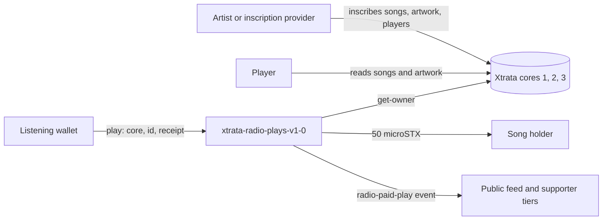
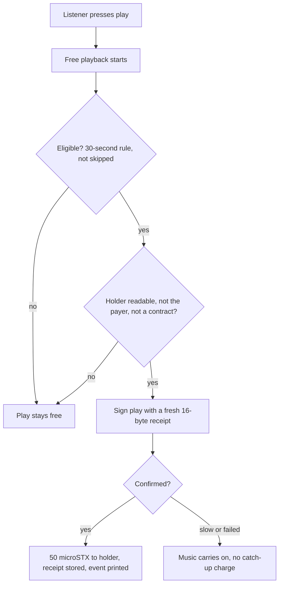

# Xtrata Music Documentation

_Last updated: 20 October 2026._

How a third party inscribes music, builds albums, runs a pay-per-play player and supports paid plays on passkey devices with Xtrata Music. Open questions are listed near the end.

## Overview

Xtrata Music is an on-chain music system on Stacks: every song is an inscription, listening is always free, and a listener can optionally pay the current song holder a few microSTX each time a song starts. Xtrata takes no platform fee.

This document is for four kinds of third party:

- **Artists and labels** who inscribe songs and artwork and want to be paid per play.
- **Player builders** who embed the radio or build their own player, wallet or album experience.
- **Inscription providers** who offer to inscribe audio and artwork for others through Xtrata.
- **Operators** who fund albums, run gift campaigns or support listeners.

Sections marked **Live** describe behaviour confirmed on the public site or contract on 20 October 2026. Sections marked **Specified** describe the agreed design that is still in review and may change before release.

| Component | Status | Where |
| --- | --- | --- |
| Free web radio (FM, Liked, Chain bands) | Live | [radio.xtrata.xyz/radio](https://radio.xtrata.xyz/radio) |
| Embeddable player (compact and minimal) | Live | [Embed page](https://radio.xtrata.xyz/radio/share.html) |
| On-chain likes | Live | [Endorse page](https://radio.xtrata.xyz/radio/endorse) |
| Paid-play contract (50 microSTX to the holder per paid start) | Live | `xtrata-radio-plays-v1-0` |
| Desktop app with a local support wallet (Mac 1.0.6, Windows 1.0.9, beta) | Live, beta | [Music lounge](https://xtrata.xyz/music/lounge) |
| Public feed of confirmed paid starts | Live | Music lounge, refreshed every 15 seconds |
| Artist portal (wallet sign-in; pay-per-play reporting coming) | Live, reporting pending | [Artist portal](https://xtrata.xyz/music/artist/) |
| Browser passkey listening wallets, numbered wallets | Specified | radio.xtrata.xyz |
| Album players with ownership checks, likes, cover art | Specified | radio.xtrata.xyz |
| Prefunded album batches, claim links, 30-day refunds | Specified | radio.xtrata.xyz |



Artists inscribe songs into the cores, players read them, and the contract looks up the holder on the core and pays them when a listening wallet asks.

## Core concepts

A song is identified by a core number and an inscription id, and every paid play pays whoever holds that song at that moment.

| Term | Meaning |
| --- | --- |
| Inscription | A file stored permanently on Stacks through an Xtrata core contract. Songs, artwork and players are all inscriptions. |
| Core | One of three Xtrata contract versions the paid-play contract understands: core 1 is `xtrata-v1-1-1`, core 2 is `xtrata-v2-1-0`, core 3 is `xtrata-v3-2-3`. The same id in two cores is two different songs. |
| Song holder | The current owner of the song inscription, read live from the core with `get-owner`. The holder receives the payment, so selling the inscription moves future income with it. |
| Player | A song inscribed as a self-contained playable page with cover art, credits and lyrics. Linked players point at an existing audio inscription instead of storing a second copy. |
| Paid play | One `play` transaction that pays the holder 50 microSTX and records a receipt. Listening itself is always free. |
| Receipt | A 16-byte value chosen by the payer, unique per payer. It makes a paid play idempotent: the same receipt can never pay twice. |
| Listening wallet | A small, separate wallet used only to pay for plays. It is not the listener's main wallet. |
| Supporter tier | A recognition level from a wallet's lifetime confirmed paid plays: 1 (First Supporter), 100, 1,000, 10,000, 100,000 and 1,000,000. Shown on [Music Heroes](https://xtrata.xyz/music/heroes). |
| Parent | A recursion link that means ownership: the new inscription becomes a child of an inscription you hold. |
| Dependency | A recursion link that means reference: the new inscription uses another inscription's content, and you do not need to own it. |
| Album (Specified) | An ordered set of songs with a title and a cover, built as one player. Only a wallet that holds every song can create it. |
| Claim link (Specified) | A link that gives a listener a funded passkey listening wallet and a copy of an album, with no seed phrase. |

## Listening wallets and passkeys

A listening wallet is a small, separate wallet that holds a few STX so plays can be paid without touching the listener's main wallet. Two forms exist: the desktop app wallet (Live) and the browser passkey wallet (Specified).

### Desktop app wallet (Live, beta)

- The app creates the wallet on the listener's computer. The key sits in the app's data folder, separate from the installed app, and is protected by the operating system (Electron safeStorage; Windows DPAPI on Windows).
- The recommended balance is around 1 STX. Higher balances are allowed with a reminder.
- Funding never turns payments on. The listener reviews the cost and approves support for each session; it is off after every restart.
- Closing the app stops new payments. A transaction already submitted can still confirm.
- The listener can return the balance to their own address, less one network fee, after pending payments are checked.
- It is a different wallet from the developer wizard wallet. Never delete a wallet folder that may hold funds.

### Browser passkey wallet (Specified)

- **Where it lives.** On its own origin, `radio.xtrata.xyz`, so the wallet is isolated from `xtrata.xyz`. No installation is needed.
- **Setup.** A listener creates a passkey, which creates a wallet, then sends it a small amount of STX. The target is 1 STX. The page warns above that and offers to sweep the excess or everything.
- **Many wallets, one passkey.** One passkey can hold several numbered wallets. After a fresh unlock, such as a page refresh, the player always opens on the first wallet, the plain player. Switching wallets inside an unlocked session resumes each wallet's last song and position.
- **Attribution.** The wallet is linked to the listener's main wallet. Likes and paid plays made from it are recorded against that main wallet, so liked playlists and supporter tier follow the listener when they log in.
- **Optional.** Listening stays free. Listeners turn paid plays on to leave on-chain proof that they paid the artist.
- **No seed phrase.** Recovery depends on the passkey, so the page must say plainly that a lost passkey with a funded balance can mean a lost balance.

### Wallet lifecycle

1. Create the wallet (app install or passkey creation).
2. Show the public funding address and ask for a small deposit on Stacks mainnet.
3. Wait for the deposit to confirm and show the confirmed balance.
4. Let the listener switch paid plays on, as a separate step from funding.
5. Pay for plays while the listener listens, never blocking playback.
6. Offer a return or sweep at any time.

## Pay-per-play

A paid play is one direct call to the `play` function of `xtrata-radio-plays-v1-0`, which pays the current song holder 50 microSTX and records a receipt in the same transaction. The contract has no custody, treasury, administrator or automatic wallet access.

### What a listener pays

| Item | Amount |
| --- | --- |
| Holder payment (fixed in the contract) | 0.000050 STX (50 microSTX) |
| Default network fee (set by the app; shown before support is enabled) | 0.000300 STX |
| Total per paid start | 0.000350 STX |
| Xtrata platform fee | None |

The network fee never increases automatically. Source: [Music lounge](https://xtrata.xyz/music/lounge).

### How a paid play works

1. The listener presses play. Free playback always starts first.
2. The player decides the play is eligible (see the rules below) and picks the song's core number and inscription id.
3. The player checks the holder with the read-only `get-owner`. If the holder is the listener's own wallet or a contract address, the play stays free.
4. The player generates 16 random bytes as the receipt and signs a `play` call with the listening wallet.
5. The contract pays 50 microSTX from the listener to the holder, stores the receipt, adds one to the song's total and prints a `radio-paid-play` event.
6. The public feed and supporter tiers pick the event up from the chain.

The diagram below shows the same flow.



### Counting rules

| Surface | When a play is paid | Status |
| --- | --- | --- |
| Desktop app | When an eligible new song starts while support is on. A paid start records a start, not a completed listen. Tracks under one minute are skipped. | Live, beta |
| Web radio with passkey wallet | After 30 seconds of listening. Skips do not pay. | Specified |

The contract cannot tell a skip from a full listen. That decision lives in the player, which is why the timer must be implemented by every third-party player that wants to pay fairly.

### Failure behaviour

- **Delayed or failed payment.** Music carries on. The start stays free, and there are no catch-up charges. New eligible starts can pay once the outstanding transaction resolves.
- **Repeated receipt.** If a retry reuses the receipt of a play that already confirmed, the contract refuses it with error 103, so a double payment is impossible.
- **One pending payment at a time** is the safe default for a listening wallet, because a stuck transaction blocks every later one from the same wallet.

## Supporting paid plays on passkey devices

When a listener has a working passkey wallet that is unlocked, funded and switched on, the player should pay for every eligible play; in every other state it must keep the music free and nudge toward the next step without ever blocking playback. This section is the recommended integration pattern, built from the contract's rules and the agreed wallet design.

### Detect the device

1. Check that the browser supports WebAuthn (`window.PublicKeyCredential` exists).
2. Ask `PublicKeyCredential.isUserVerifyingPlatformAuthenticatorAvailable()` to learn whether the device can verify the user with a fingerprint, face or screen lock.
3. Look for an existing Xtrata listening wallet for this origin. A wallet is a stored credential plus its linked main wallet.
4. Read the wallet's confirmed STX balance and whether paid plays are switched on.

### Choose the play mode

| State detected | What the player does |
| --- | --- |
| Wallet unlocked, funded, paid plays on | Pay each eligible play after the 30-second rule. This is the default whenever it is possible. |
| Wallet exists but is locked | Keep playing free. Show one unlock prompt, which needs a tap or click because passkeys require a user gesture. After unlock, open the first wallet. |
| Wallet unlocked and funded, paid plays off | Keep playing free. Offer the switch once, with the cost shown. Funding alone never turns payments on. |
| Wallet balance low | Keep paying while funds last. Warn before the balance can no longer cover a play. |
| Wallet empty, or gifted plays used up | Play free. Show the deposit prompt now, and not before. |
| Passkeys supported, no wallet yet | Play free. Offer to set up a listening wallet. |
| Passkeys unsupported, or no platform authenticator | Play free. Offer the desktop app or a connected wallet instead. |
| Payment pending, delayed or failed | Play free. Do not queue catch-up payments. |

### Pre-flight checks before each paid play

- **Direct caller.** The contract requires that the transaction sender is also the direct caller (error 100). A passkey wallet must sign as a normal Stacks address. A smart-contract account that forwards the call cannot pay plays.
- **Holder is readable.** Call `get-owner(core, id)`. An error means the core is unknown.
- **Holder is not the payer.** A wallet cannot pay itself (error 105).
- **Holder is a normal address.** Songs held by an escrow or marketplace contract cannot be paid yet (error 106). Treat these as free plays.
- **Fresh receipt.** Use 16 new random bytes for every paid play, and keep the receipt with the pending transaction so a retry cannot pay twice.

### Keeping paid plays in use

- Remember the listener's choice. Ask once to switch paid plays on, then keep it on for that wallet instead of asking each session.
- Show the remaining plays or balance quietly, as the only number on screen. Keep crypto wording out of the listener view of an album player.
- Offer a top-up when the balance falls low, and a gift or claim link where the artist has funded plays.
- Keep playback unbroken when payment is slow, and report the payment state in plain words.
- Show supporter progress (First Supporter at 1 paid play, then tiers at 100, 1,000, 10,000 and above) as a reason to keep the wallet funded.

### What never to do

- Never spend from a wallet the listener has not switched on.
- Never ask for, log or transmit a seed phrase, private key or passkey material.
- Never present paid plays as required. Free listening must stay available.

## Albums and players (Specified)

An album is a player with a title, an ordered list of songs and a cover, and only the wallet that holds every song in it can create it. This section is the agreed design, in review as of 20 October 2026; the contract and page names are not final.

### Rules

- **Ownership gate.** The creating wallet must hold all the songs. This stops anyone from packaging music they do not control.
- **Stays an album.** A gifted album remains an album player. It does not turn into a general player with other playlists.
- **No duplicates.** A wallet or passkey can never own the same album twice.
- **No free play on a given-out wallet.** Wallets handed to new listeners do not allow free play of other music. The first, default wallet can still play other music once the listener funds it.
- **Listener view.** Artwork, artist and song titles up front, with plays remaining as the only value shown. No pay, STX or crypto wording; everything else is collapsed away. The listener-facing player is branded Xtrata Music.
- **Likes and cover art** are part of the player and are recorded against the linked main wallet.

### Creating an album

1. Inscribe each song with the [Music wizard](https://xtrata.xyz/music/), as a player with artwork, credits and lyrics. Use **Number the tracks** so the order is stored.
2. Check that one wallet holds every song inscription.
3. Choose a title, the song order and a cover. A cover can be uploaded or linked from an existing image inscription.
4. Create the album player from that wallet. The tool refuses if any song is missing.
5. Fund the album through the prefunded route (next section) and create claim links.

### Third-party players and albums

- Read an album as an ordered list of song references, each a core number plus an inscription id. Use those pairs for every paid play so the right holder is paid.
- Do not let a listener add other music to a gifted album wallet's album view.
- Respect the ownership gate when you build your own album tool. Check holdings on-chain at creation time, not from a cached list.

## Distribution and gift links (Specified)

Every creator, Xtrata included, distributes albums and EPs through one prefunded route: the creator stocks the funds up front, the funds are locked, and anything unclaimed returns to the creator after 30 days. There is no treasury-paid route.

### How it works

1. The creator decides how many copies to release and how many plays each copy carries.
2. The creator funds the batch. The funds are locked for plays and network fees, so the listener never needs STX to start.
3. The system creates one claim link per copy.
4. A listener opens a link and receives a passkey listening wallet that already holds the album and its plays, with no seed phrase.
5. Each play from that wallet pays the song holders as normal. Plays remaining is the number the listener sees.
6. Links that are still unclaimed after 30 days expire, and their funds are refunded to the creator.

### Rules for claim links

- A link can be claimed once. A wallet or passkey can never receive the same album twice.
- STX deposit prompts appear only after the listener has used up their free gifted plays, never while gifted plays are still arriving.
- Gift and batch tooling is for administrators and creators. The listener-facing "send music to a friend" gift is removed for now.
- Gift administration is controlled by a small set of admin wallets (`RADIO_GIFT_ADMIN`): jim.btc, xtrata.btc and audionals.btc. Their addresses will be published with the release.

### Campaign pattern: one link at a time

A public page can release about 100 prepaid album links one at a time: the next link appears only after the previous one is claimed. This shows non-crypto audiences how simple the player is, and it keeps each link scarce. Third parties can copy the pattern by funding their own batch and publishing links in sequence.

### Caveats for integrators

- Do not promise listeners specific play counts before the batch is funded.
- Treat a claim link as a bearer link. Anyone with it can claim, so share it only where the creator is happy for that to happen.
- Show the expiry date to the creator when the batch is created.

## Inscription services

A third party can offer inscription of songs and artwork by sending people to Xtrata's hosted wizards or by building the same flow into their own site; either way the user pays once into a one-shot wallet their own browser controls, and Xtrata never holds the funds. Everything below is confirmed on the live [Music wizard](https://xtrata.xyz/music/) and [Inscription Wizard](https://radio.xtrata.xyz/wizard/).

### The inscription flow

1. **Drop.** The user drops one song or several tracks. Metadata and artwork are optional.
2. **Prepare and preview.** Files are prepared on the user's device, and the user can play the finished output before paying.
3. **Pay once.** The user's browser creates a new wallet for this one job. The user pays into it. The quote is based on the finished output's exact size and is over-collected for fees.
4. **Inscribe.** The one-shot wallet does the work and keeps the browser tab busy, so the tab must stay open. A "Finish this without me" option hands the job to Xtrata's server after the user agrees.
5. **Deliver.** The inscription and any change go straight back to the user. The wallet is emptied and its key destroyed. Unused fee funds are refunded on delivery.
6. **Recover.** If the tab closes, the user can resume the job or ask for a refund. "Stop this job and refund me" stops at the next safe point. Anything already uploaded stays on-chain unsealed and costs nothing more.

### What a user can choose

| Choice | Options |
| --- | --- |
| What to inscribe | Audio only; audio plus metadata; audio plus metadata plus artwork |
| Audio quality | Keep original file; Smallest (Opus 48 kbps VBR); Balanced (Opus 96 kbps VBR, default); High (Opus 128 kbps VBR); Extra (Opus 160 kbps VBR) |
| Processing budget | Standard (more room for network fee changes) or Economy (lower initial budget) |
| Artwork | Upload a PNG, JPEG or WebP, or link an image inscription (PNG, JPEG, WebP, GIF or AVIF) for zero extra bytes |
| Audio source | New file, or an existing plain-audio inscription (MP3, WAV, FLAC, M4A, OGG, WebM) |
| On-chain receipt | Optional second token recording what was paid; a readable receipt is saved either way |
| Metadata | Title, artist, album, track number, BPM, note, licence, description, lyrics, featured artists, genre, release date, language, songwriters, performers, producer, engineer, rights holder |

Optimising audio is lossy, so the interface tells users to keep their original master. In a batch, "Apply to all" sets shared details such as artist, album and cover once.

### Offering the service

- **Route people to the hosted wizards.** The simplest option. The wizard is backendless: it runs in the browser, and `?mock=1` rehearses a job offline.
- **Build your own front end** around the same one-shot wallet pattern. Quote on finished size, over-collect for fees, refund the rest, and never route user funds through your own wallet.
- **Use the helper tools** that ship beside the wizard: SUNO fast-track, Manifest Studio, the simple on-site inscriber and the Xtrata Xplorer.
- **Contract and SDK details** for building your own tool are in the `stxtrata/xtrata` repository under `xtrata-2.0`. They were not reviewed for this document.

### Obligations for anyone offering inscription

- Tell users before they pay that the files and details become public and permanent.
- Make users confirm they have permission to publish the material. Credits and rights information come from the user.
- Let users preview the finished output before funding.
- Offer a refund path for unfinished jobs.

## Recursion: music and artwork that reference other inscriptions

An inscription can point at other inscriptions in four ways, and a player must resolve each one before it can play or show anything. Parent and dependency links are set in the wizard's Relationships panel; linked audio and linked artwork are chosen where the song and cover are added.

| Link | Meaning | Rules |
| --- | --- | --- |
| Parent | Ownership. The new song becomes a child of an inscription you hold. | One parent per song, because players are large and large inscriptions seal with a single parent. The user sends the parent to the one-shot deposit wallet with the payment; parent, song and change all come back. In a batch, one parent is escrowed once and linked to every song. |
| Dependency | Reference. The new inscription uses another inscription, and the user does not need to own it. | Anything can reference anything. Dependencies add nothing to the quote. In a batch they apply to every song. |
| Linked audio | A player uses an existing plain-audio inscription instead of storing a second copy. | Costs a few cents to inscribe. MP3, WAV, FLAC, M4A, OGG and WebM only, not HTML players. The player is only as permanent as the link. |
| Linked artwork | A player or album uses an existing image inscription as its cover. | Zero extra bytes. PNG, JPEG, WebP, GIF or AVIF. |

The Inscription Wizard also has a dependency graph composer. It lays out existing and new inscriptions as nodes, draws arrows from each node to the inscriptions it depends on, and sends a new node's resolved dependencies to the wizard.

### What a player must do

1. Read the inscription's links before playback and resolve each referenced inscription from the chain.
2. Fetch audio and artwork from the linked inscriptions, not from a copy.
3. Fail softly. If a link cannot be resolved, show the song as unavailable and skip it. Never block the rest of the album.
4. Identify every inscription by its core number and id. The same id in two cores is two different inscriptions.
5. Show related inscriptions where available. The radio's "View inscription" action opens the current song's inscription with artist details, artwork and related inscriptions.

### Recursion and who gets paid

The paid-play contract pays exactly one holder: the owner of the `(core, id)` pair that the player passes in. It has no split built in, so a song that links to someone else's audio does not pay that audio's holder unless the player calls `play` for that inscription as well. Integrators should decide and publish which inscription counts as the song, and keep that rule the same across their player.

### Practical advice for artists

- Link shared artwork and shared audio by inscription id to save fees, and keep a copy of the original master off-chain.
- Use a parent link only for inscriptions you own, such as an album parent for its songs.
- Treat a linked inscription as outside your control. If its content can change hands, the holder changes with it.

## Integrator checklists

Each list is the shortest route to a working setup for one kind of third party.

### Artist or label

1. Open the [Music wizard](https://xtrata.xyz/music/) and connect the wallet that should receive income. That wallet becomes the song holder.
2. Inscribe each song as a player with title, artist, artwork, credits and lyrics. Keep your original master.
3. Preview the finished output before you pay. Check the quote.
4. Confirm the inscription arrived in your wallet.
5. Open the [artist portal](https://xtrata.xyz/music/artist/) and sign in by signing a free message with your receiving wallet.
6. Watch confirmed plays in the public feed on the [Music lounge](https://xtrata.xyz/music/lounge). Personal pay-per-play reporting in the portal is still being prepared.
7. Keep the holding wallet as a standard address. Songs held by a contract cannot receive paid plays yet.
8. To release an album, follow the album and distribution sections above once they are live.

### Player builder

1. Load songs from Xtrata's hosted inscription services, which the radio and catalogue use, or from your own indexer, and resolve every linked audio and artwork inscription.
2. Add the free player first. Add the embed (`/radio/embed.html`) if you only need playback.
3. Add the listening wallet: create, fund, and switch on, as separate steps.
4. Implement the 30-second rule and the pre-flight checks.
5. Generate a unique 16-byte receipt per paid play and sign a direct `play` call.
6. Keep music playing through every payment failure.
7. Read `get-total` and the `radio-paid-play` events to show confirmed plays.
8. Add a way to return or sweep the wallet balance.

### Inscription provider

1. Decide whether to host the wizard flow or send users to Xtrata's wizards.
2. If you host it, use a one-shot wallet created in the user's browser. Never pool or hold user funds.
3. Quote from the finished output's size, over-collect for fees and refund the remainder on delivery.
4. Show a preview before payment and a public-and-permanent warning.
5. Offer resume and refund for unfinished jobs.
6. Support parent and dependency links, and linked audio and artwork.

### Operator or campaign runner

1. Decide the number of copies and the plays per copy.
2. Fund the batch through the prefunded route, and note the 30-day expiry.
3. Publish claim links one at a time or in bulk, as your campaign needs.
4. Watch claims and refunds. Expect unclaimed funds to return after 30 days.
5. Keep deposit prompts for after gifted plays are used.

## Reference: paid-play contract

Contract `SP3JNSEXAZP4BDSHV0DN3M8R3P0MY0EEBQQZX743X.xtrata-radio-plays-v1-0` on Stacks mainnet, published at block 8994597, Clarity 6. The tables below were read from its live interface and source on 20 October 2026.

### Functions

| Function | Access | Arguments | Returns |
| --- | --- | --- | --- |
| `play` | public | `core` uint, `id` uint, `receipt` (buff 16) | ok: `{amount, recipient, total}`; err: uint |
| `get-config` | read-only | none | ok: `{version, holder-payment, receipt-bytes, core-1, core-2, core-3}` |
| `get-owner` | read-only | `core` uint, `id` uint | ok: optional principal; err: uint |
| `get-receipt` | read-only | `payer` principal, `receipt` (buff 16) | optional `{core, id, recipient}` |
| `get-total` | read-only | `core` uint, `id` uint | uint, the paid plays recorded for that song |

### Constants and cores

| Name | Value |
| --- | --- |
| `HOLDER-PAYMENT` | 50 microSTX (0.000050 STX) |
| Receipt length | 16 bytes |
| Version | 1 |
| Core 1 | `SP3JNSEXAZP4BDSHV0DN3M8R3P0MY0EEBQQZX743X.xtrata-v1-1-1` |
| Core 2 | `SP3JNSEXAZP4BDSHV0DN3M8R3P0MY0EEBQQZX743X.xtrata-v2-1-0` |
| Core 3 | `SP3JNSEXAZP4BDSHV0DN3M8R3P0MY0EEBQQZX743X.xtrata-v3-2-3` |

### Error codes from `play`

| Code | Cause | What a player should do |
| --- | --- | --- |
| u100 | The sender is not the direct caller (called through another contract) | Sign as a standard address. Do not route through a contract account. |
| u101 | Unknown core number (from `get-owner`) | Use core 1, 2 or 3 only. |
| u102 | Receipt is not exactly 16 bytes | Send 16 bytes. |
| u103 | This payer already used this receipt | Treat as already paid. Generate a new receipt for the next play. |
| u104 | The song has no owner | Play free. |
| u105 | The holder is the payer | Play free. |
| u106 | The holder is a contract address | Play free until a separate beneficiary resolver is reviewed. |

### Event

Every successful `play` prints one event, which indexers and feeds read from the transaction.

```
{ event: "radio-paid-play", version: u1, core, id,
  payer, receipt, recipient, amount: u50, total }
```

`total` is the song's running count after this play. `amount` excludes the network fee.

### Calling it

A standard transaction needs a post-condition for the 50 microSTX transfer from the payer, because the contract moves STX. Build the call with your Stacks library of choice and check its current API:

- Contract address: `SP3JNSEXAZP4BDSHV0DN3M8R3P0MY0EEBQQZX743X`; contract name: `xtrata-radio-plays-v1-0`; function: `play`.
- Arguments in order: core as uint, id as uint, receipt as a 16-byte buffer.
- Post-condition: the payer sends exactly 50 microSTX.
- Fee: your choice; the desktop app defaults to 0.000300 STX.

### Other public endpoints

| Item | Where |
| --- | --- |
| Free web radio | `https://radio.xtrata.xyz/radio` |
| Embed (compact) | `https://xtrata.xyz/radio/embed.html` |
| Embed (minimal) | `https://xtrata.xyz/radio/embed.html?mode=minimal` (height 72) |
| On-chain likes | `https://xtrata.xyz/radio/endorse` |
| Song statistics | `https://radio.xtrata.xyz/radio/catalogue` |
| Live paid plays | `https://xtrata.xyz/music/lounge#live-payments` |
| Music Heroes leaderboard | `https://xtrata.xyz/music/heroes` |
| Desktop app downloads | `https://xtrata.xyz/music/lounge#downloads` |

### Embed details

The compact embed is an iframe `https://xtrata.xyz/radio/embed.html`, 100% wide, 140 high, with `allow="autoplay"`. Keep it at least 240 pixels wide. Your site's Content Security Policy must allow `https://xtrata.xyz` in `frame-src`. The embed needs no API key and no wallet, runs its own listening session per iframe, and is not a continuous MP3 or HLS stream. There is no parent-control API in this release, and paid plays are not part of the embed.

## Security and operations

The paid-play contract holds no funds and has no administrator, so the main risks sit in the wallets and in the player around it.

### Wallet safety

- Keep a small balance, around 1 STX, in any listening wallet. It is not a savings wallet.
- Never request, display, copy, log or transmit a seed phrase, private key, vault file, unlock file or raw signed transaction.
- Never use a personal, deployer, sponsor or already-connected wallet for tests.
- Never send STX, create a return, switch on paid plays or sign a transaction unless the listener has asked for that exact action and seen the destination and amount.
- Keep the wallet on its own origin (`radio.xtrata.xyz` for passkey wallets) so another page cannot read it.
- Do not delete a wallet folder or credential that may hold funds. Return the balance first and wait for confirmation.

### Installing the desktop app

- Verify the SHA-256 of the download against the value on the Music lounge before opening it.
- Current builds are unsigned betas: Mac 1.0.6 and Windows 1.0.9. Let the user handle each operating-system security prompt. Never disable system protections.
- If you run the app from the source package on macOS or Linux, it needs Node.js 24 and binds only to `127.0.0.1` (normally port 8798). Never expose that port to a network. On Windows the source package cannot create a wallet; use the desktop app.

### Operating a campaign or gift service

- Limit gift administration to the named admin wallets.
- Lock batch funds up front and honour the 30-day refund.
- Track claims, expiries and refunds for every batch.

### Monitoring

- Read the contract's `radio-paid-play` events for confirmed plays. The Music lounge feed refreshes every 15 seconds.
- Compare `get-total` for a song with the event count when you audit.
- Watch for repeated u103, u105 and u106 errors, which point to a player bug or a holder that cannot be paid.

### Privacy

- Radio statistics use a random browser identifier, not a wallet. Server records are kept for up to 90 days. The browser's Global Privacy Control signal disables counting.
- On-chain likes and paid plays are public and show the wallet address. Say so before the listener approves.

## FAQ and open questions

### Frequently asked

**Is listening free?** Yes. Free listening is always available, and paid plays are optional.

**Who gets paid?** The current holder of the song inscription, read from the core contract at the moment of the play. If the song is sold, later plays pay the new holder.

**Does Xtrata take a cut?** No. The cost per paid start is the 50 microSTX holder payment plus the network fee.

**Can a listener pay for a song they own?** No. The contract refuses it (error 105), so the player should treat it as a free play.

**Can a song held by a marketplace or escrow contract be paid?** Not yet. The contract refuses a contract-address holder (error 106) until a separate beneficiary resolver is reviewed.

**Why does a passkey wallet need to be a normal address?** `play` requires that the sender is the direct caller. A wallet that works through its own smart contract cannot satisfy that check.

**What happens to the music when a payment is slow?** It keeps playing. The start stays free, and nothing is charged later to catch up.

**Does a paid play prove someone listened?** No. Paid starts record a start, and a wallet is not necessarily a person.

**Can I embed the radio on my site?** Yes, with the iframe described in the reference section. The embed plays music but has no wallet and does not pay.

### Open questions to confirm before release

- [ ] Which inscription id does a player pass for a song that links to another inscription's audio: the player or the audio?
- [ ] Where is the 30-second rule enforced for the web radio, in the client only or with an on-chain check?
- [ ] What is the album contract or registry name, and does it keep ownership checks on-chain?
- [ ] What is the claim-link format, and which contract holds locked batch funds and returns them after 30 days?
- [ ] Which public addresses belong to the three `RADIO_GIFT_ADMIN` wallets?
- [ ] How is the passkey wallet key derived and stored, and what does recovery look like when a device is lost?
- [ ] Is there a documented SDK or API for third parties who want to host inscription, and what are the current inscription fees?
- [ ] When will artist pay-per-play reporting in the portal go live?
- [ ] Should gift tooling for listeners return, and under what limits?

## Sources

Pages and files opened on 20 October 2026. Sections marked Specified also draw on the project owner's own design decisions, which are not yet public.

- [Xtrata Music Listening Room](https://xtrata.xyz/music/lounge): costs, desktop app, support flow, downloads and checksums.
- [Xtrata Radio](https://radio.xtrata.xyz/radio) and its [listening guide](https://radio.xtrata.xyz/radio/guide.html): bands, likes, statistics, privacy.
- [Embed Xtrata Radio](https://radio.xtrata.xyz/radio/share.html) and the [embedding guide](https://github.com/stxtrata/xtrata/blob/main/xtrata-2.0/docs/radio-embed.md): iframe options and limits.
- [Xtrata Music AI install guide](https://github.com/stxtrata/xtrata/blob/main/xtrata-2.0/docs/radio/AI-MUSIC-SUPPORT-INSTALL.md): wallet safety, install routes, validation.
- [Listener guide source](https://github.com/stxtrata/xtrata/blob/main/xtrata-2.0/docs/radio-listener-guide.md).
- [Music wizard](https://xtrata.xyz/music/) and [Inscription Wizard](https://radio.xtrata.xyz/wizard/): inscription flow, options, relationships.
- [Artist portal](https://xtrata.xyz/music/artist/) and [pay-per-play page](https://xtrata.xyz/music/artist/royalties/plays/).
- [Music Heroes](https://xtrata.xyz/music/heroes): supporter tiers.
- [On-chain likes](https://xtrata.xyz/radio/endorse).
- [Contract interface](https://api.hiro.so/v2/contracts/interface/SP3JNSEXAZP4BDSHV0DN3M8R3P0MY0EEBQQZX743X/xtrata-radio-plays-v1-0) and [contract source](https://api.hiro.so/v2/contracts/source/SP3JNSEXAZP4BDSHV0DN3M8R3P0MY0EEBQQZX743X/xtrata-radio-plays-v1-0), read through the Hiro API.
